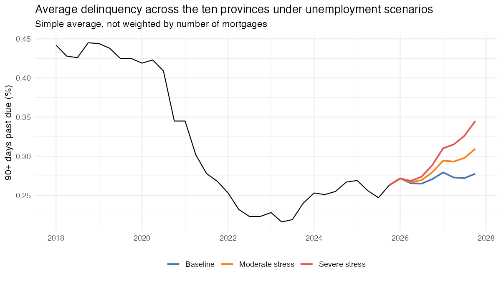

# Canada Mortgage Delinquency: Unemployment, Interest Rates and Out-of-Sample Validation

Panel model of mortgage delinquency in Canada, 2012 to March 2026, with out-of-sample validation and unemployment stress scenarios. 

## Question

How are unemployment and the Bank of Canada policy rate associated with mortgage delinquency across Canadian provinces and Census Metropolitan Areas (CMA), and how much of next quarter's delinquency can a model actually predict?

## Main results

- **Unemployment moves with delinquency.** In the main provincial model, one more point of unemployment is associated with roughly 17 to 19% higher delinquency. The result holds with 33 metropolitan areas instead of 10 provinces (0.154 vs 0.171 on log delinquency) and when the COVID quarters are dropped.
- **Delinquency is persistent and it shapes the rest.** Last quarter´s delinquency explains almost all of this quarter´s (coefficient 0.93 to 0.96). The effect of unemployment is real but builds slowly: 1% in the first quarter and 20 to 28% in the long run.
- **It weakens within a province.** Comparing metropolitan areas of the same province in the same quarter, the association falls to 0.03 and is only marginally significant. Most of the link comes from the cycle areas share, not from local differences.
- **The policy rate cannot be separated.** It is a single national series with one rate cycle in the sample. Its coefficient is negative at every lag and loses significance when errors are clustered by province.
- **Predicting one quarter ahead is hard to improve on.** Adding unemployment or the policy rate does not beat persistence alone in a way that can be told apart from chance. A random forest (which can capture non linear effects), cuts the error by 8% when predicting quarterly changes (better in 13 of 16 quarters) but the gain is not statistically significant (p= 0.13) No model anticipated the turn of 2023.
- **Stress scenarios.** Eight quarters after a 2-point rise in unemployment, delinquency is 11% above the baseline path and after a 4-point rise is 24% above.
- **The association is positive in every province,** from 0.09 (Alberta) to 0.30 (Prince Edward Island).



## Stress scenarios
Delinquency is projected ahead under three unemployment paths. In the baseline model, unemployment stays as its last level. In the moderate stress scenario it rises by 2 percentage points
over four quarters and then holds. In the severe stress scenario it rises by 4 points. These are conditional projections, not forecasts. In this project, only unemployment is stressed.
It is important to acknowledge that in a real downturn house prices and interest rates also move.

## Models and results

Each model adds one element to the baseline: unemployment, the policy rate, or a nonlinear learner. Predictions are one quarter ahead, in an expanding window over 16 test quarters (2022Q1 to 2025Q4), 10 provinces.

| Model | What it does |
|---|---|
| Last-quarter benchmark | Predicts last quarter's value. Nothing is estimated |
| Persistence only (baseline) | Last quarter's delinquency, plus province and quarter-of-year effects |
| Persistence + unemployment | Baseline plus lagged unemployment and a COVID indicator |
| Persistence + unemployment + policy rate | Adds the policy rate lagged four quarters |
| Economy only | Unemployment and COVID, without persistence |
| Random forest (level) | Predicts the delinquency level |
| Random forest (change) | Predicts the quarterly change |

| Model | RMSE | MAE | RMSE vs baseline |
|---|---|---|---|
| Random forest (change) | 0.089 | 0.065 | -8% |
| Persistence + unemployment + policy rate | 0.093 | 0.072 | -3% |
| Last-quarter benchmark | 0.093 | 0.069 | -3% |
| Persistence + unemployment | 0.094 | 0.070 | -2.5% |
| **Persistence only (baseline)** | 0.096 | 0.071 | n/a |
| Random forest (level) | 0.135 | 0.096 | +40% |
| Economy only | 0.453 | 0.381 | +370% |

Errors are in log points. Against the baseline (Diebold-Mariano test on 16 test quarters), only the economy-only model and the level random forest are distinguishable, and both are worse. The random forest on changes lowers the error in 13 of 16 quarters, but the average gain is small relative to quarter-to-quarter variation (p = 0.13).

## Limitations

- The results are just associations, there are not causal effects. There are omitted variables that can move with unemployment (house prices, income, credit conditions) and also drive part of the link.
- The policy rate has one large movement in the sample (2022 to 2023) and is the same for all provinces, so its effect cannot be separated from other national changes in those years.
- There are 10 provinces so clustered errors with so few groups are unreliable. For that reason, models are repeated with 33 metropolitan areas. Ontario accounts for 15 of them.
- Metropolitan unemployment comes from a survey with small samples, so it is measured with noise.
- Scenario paths are conditional projections, not forecasts, and have no confidence bands. Averages across provinces are simple, not weighted by number of mortgages.

Methods, including why fixed effects and how I handle omitted variable bias and COVID, are in the...

## Data

- Mortgage delinquency rate (90+ days past due, share of loans): [CMHC / Equifax](https://www.cmhc-schl.gc.ca/en/data-and-research/data-tables/mortgage-delinquency-rate-canada-provinces-cmas). Not seasonally adjusted. **Manual download.**
- Unemployment rate: Statistics Canada Labour Force Survey, tables 14-10-0287-01 (provinces) and 14-10-0459-01 (metropolitan areas), seasonally adjusted.
- Policy rate: Bank of Canada Valet API, series V39079.

## How to reproduce

1. Clone the repository and open `Canada_mortgage_risk.Rproj` in RStudio.
2. Install the packages: install.packages(c("broom", "cansim", "dplyr", "fixest", "ggplot2",
                   "jsonlite", "ranger", "readr", "readxl", "tidyr")).
3. Download the CMHC Excel file and save it as `data/raw/cmhc_delinquency.xlsx`.
4. Run `source("R/00_run_all.R")`. Statistics Canada and Bank of Canada data download automatically. It takes around [N] minutes.
5. Render the report: `quarto render reports/report.qmd`.

## Repository structure

```
R/              analysis scripts, run in order by 00_run_all.R
R/exploration/  data inspection scripts, not part of the pipeline
data/           raw and processed data (not tracked, rebuilt by the scripts)
outputs/        model tables, validation scores, scenario paths
outputs/figures figures used in the report
reports/        Quarto report
```

## Notes

I used Claude as a coding assistant for this project, mainly for debugging R code. I made the design choices, ran all analyses, and am responsible for the results and conclusions.
